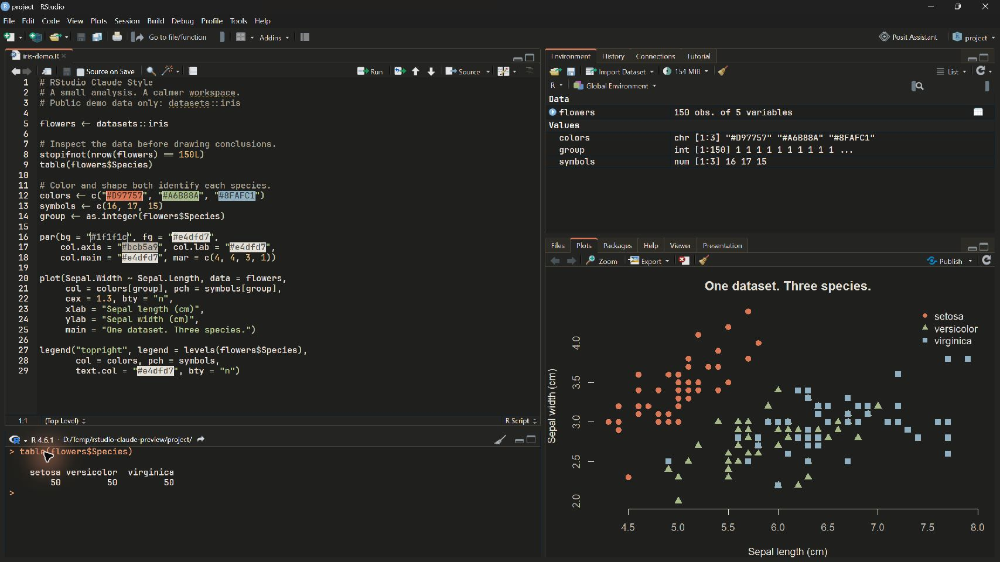
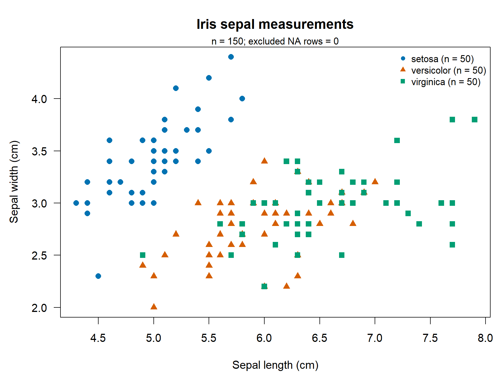

<div align="center">

# RStudio Claude Style

### Claude Code-inspired themes and focused AI workflows for RStudio.

Warm charcoal. Softer contrast. Your code, data, and plots in one workspace.

[](LICENSE) [](https://github.com/Nigmat-future/rstudio-claude-style/stargazers) [](https://github.com/Nigmat-future/rstudio-claude-style/commits/main/)

[Install the theme](#quick-start) · [Add AI workflows](#ai-workflows-in-posit-assistant) · [Compatibility](#tested-environment) · [Report an issue](https://github.com/Nigmat-future/rstudio-claude-style/issues)



<sub>Claude Terminal Charcoal in a real RStudio session. Public iris data; no personal code or chat history.</sub>

</div>

Two native RStudio themes and two optional Posit Assistant skills. Give your editor a warmer palette, review selected R code, and turn real data into reproducible figures.

The preview shows the theme. Plot colors come from the [demo script](examples/theme-preview.R); installing a theme does not recolor your plots.

## Quick start

**Requires RStudio.** The theme works on its own; AI workflows additionally require a working Posit Assistant setup and configured model.

[Download and extract the ZIP](https://github.com/Nigmat-future/rstudio-claude-style/archive/refs/heads/main.zip), or clone:

```sh
git clone https://github.com/Nigmat-future/rstudio-claude-style.git
cd rstudio-claude-style
```

In **Tools > Global Options > Appearance**:

1. Note your current themes, then click **Add…** and select `themes/claude-terminal-charcoal.rstheme`.
2. Set **RStudio theme** to **Modern** and **Editor theme** to **Claude Terminal Charcoal**.
3. Click **Apply / OK**.

Prefer the original palette? Import [`themes/claude-terminal.rstheme`](themes/claude-terminal.rstheme) instead. Switch back in Appearance whenever you like.

<details>
<summary><strong>Install from the RStudio Console</strong></summary>

Already have `rstudioapi` installed? Run this in the RStudio Console from the repository root:

```r
rstudioapi::addTheme("themes/claude-terminal-charcoal.rstheme", apply = TRUE)
```

Existing themes are not overwritten by default. See [`rstudioapi::addTheme()`](https://rstudio.github.io/rstudioapi/reference/addTheme.html).

</details>

**Like the look? [Star the project](https://github.com/Nigmat-future/rstudio-claude-style) to help other R users find it.**

## Why this setup

- **Keep your RStudio workflow.** Warm charcoal, ivory text, and terracotta accents across the editor, Console, Terminal, and selected IDE surfaces.
- **Get help with the code you selected.** `/r-code` guides explanation, diagnosis, focused edits, and a small runnable check.
- **Keep the figure and the code behind it.** `/r-plot` guides data inspection, plotting, visual review, and R script plus PNG/PDF export.
- **Start with the parts you need.** Themes are static `.rstheme` files; skills use Assistant's existing tools. The basic setup adds no background service or R package dependency.

## AI workflows in Posit Assistant

These skills are instructions for **Posit Assistant inside RStudio**. They use its existing editor, R-session, and plotting tools; available actions depend on your model, mode, and permissions. The skill definitions are currently in Chinese; the prompts below are in English.

### Install the skills

Copy the `skills/r-code` and `skills/r-plot` folders into:

```text
~/.posit/assistant/skills/
```

Keep the `skill-name/SKILL.md` structure. If a folder already exists, compare its contents before replacing your version. Start a **new Assistant conversation**, type `/r-`, and select a skill.

<details>
<summary><strong>Windows: copy both skills with PowerShell</strong></summary>

Run from the repository root. This stops if either destination already exists.

```powershell
$skillRoot = Join-Path $env:USERPROFILE '.posit/assistant/skills'
foreach ($name in 'r-code', 'r-plot') {
    if (Test-Path -LiteralPath (Join-Path $skillRoot $name)) {
        throw "Skill already exists: $name"
    }
}
New-Item -ItemType Directory -Path $skillRoot -Force | Out-Null
Copy-Item -LiteralPath './skills/r-code', './skills/r-plot' -Destination $skillRoot -Recurse
```

If the commands do not appear, check the folder structure and your `skills.paths` setting, then reload Assistant. See the [official skill-loading rules](https://assistant.posit.co/docs/features/skills/).

</details>

### Try a prompt

Select code in the editor, press **Ctrl+Shift+I** to open the sidebar on the tested Windows setup, and choose a model you have configured.

**Understand the code in front of you.** Use Ask mode for explanation and review:

```text
/r-code Explain this selection. Check NA handling and grouping assumptions.
Point out the smallest useful fix and show how to verify it.
```

**Take a figure all the way to an editable result.** Use a mode that permits editing and R execution:

```text
/r-plot Use iris from my R session. Plot Sepal.Length against Sepal.Width,
grouped by Species. Include units, group sizes, and missing-value handling.
Review the figure, then save the R script and PNG/PDF in a new directory.
Do not overwrite existing files.
```

> Independent community project. “Claude style” describes the appearance and workflow. This is not a Claude Code port or an official Anthropic, OpenAI, or Posit product. Bring your own model access; no account, subscription, or API credit is included.

## Reproduce the preview

To reproduce the screenshot's public demo, open and source [`examples/theme-preview.R`](examples/theme-preview.R) inside RStudio. It uses only base R and the built-in `iris` dataset. It changes graphics settings in the current session to match the theme.

For a separate, self-checking PNG/PDF export example, run:

```sh
Rscript --vanilla ./examples/plot-demo.R ./demo-output
```

Or, from RStudio at the repository root:

```r
source("examples/plot-demo.R")
plot_demo("demo-output")
```

Choose an output directory without existing files of the same name. `source()` defines the function; the command-line version also runs the checks described below.

<details>
<summary><strong>View the export and its checks</strong></summary>



The command-line example checks 150 observations, three groups of 50, zero excluded NA rows, successful PNG/PDF exports, closed graphics devices, and refusal to overwrite existing results.

</details>

## Tested environment

| Component | Tested version |
| :--- | :--- |
| OS | Windows |
| RStudio | `2026.09.0+174` |
| Posit Assistant | `1.8.0` |
| Bundled Codex | `0.154.0` |
| R | `4.6.1` |
| Node.js — optional compatibility tools only | `22.23.1` |

Other versions and operating systems have not been verified. Some IDE selectors depend on the tested RStudio build and may change after an update. Native windows, the OS title bar, and the contents of the Assistant iframe retain their own styling. Layout, font sizes, shortcuts, and permissions are unchanged by the theme.

## Optional Windows compatibility fix

**If Codex already works in Assistant, skip this section.** The theme and skills do not require the patch.

<details>
<summary><strong>Fix “Codex did not trust” on the tested Assistant / Codex combination</strong></summary>

The affected adapter writes a fixed Unix-style hook trust key, while Windows Codex returns a Windows-style key. This patch retains the target policy hook's observed `key` and `currentHash` for the next startup attempt. Trust checks and tool approvals remain enabled.

Save your work. In **Tools > Global Options > Assistant > Chat provider**, select **(None)** and Apply to stop the Chat backend. Leave the code-completion provider alone. Then run from the repository root:

```powershell
node ./fix-codex-hook.mjs --check
node --test ./tests/fix-codex-hook.test.mjs
node ./fix-codex-hook.mjs --apply
node ./check-codex-hooks.mjs --bundle "$env:LOCALAPPDATA/RStudio/pai/bin/dist/server/main.js"
```

The patcher accepts four exact snippets from the reviewed adapter; this is **not full-bundle version or hash authentication**. An incompatible match is rejected. For a non-default location, pass `--bundle 'full/path/to/main.js'`. Do not force the patch onto an unreviewed update.

The original file is backed up beside the bundle as `main.js.before-windows-hook-fix`. Target updates use a temporary file in the same directory, and an existing backup with different contents is never overwritten. Keep the backup if installation fails.

The check starts the real Codex app-server in a temporary `CODEX_HOME` and calls only initialization and `hooks/list`. It does not log in, request a model response, or execute MCP tools. The default executable is the bundled Windows x64 Codex `0.154.0`; use `--codex 'full/path/to/codex.exe'` for another location.

Expected comparison: `legacy` is `untrusted`; `corrected` is `trusted`. Running `node ./check-codex-hooks.mjs --legacy` deliberately exits **1** on the affected version to reproduce the original failure. A passing comparison verifies hook trust, not a complete model conversation.

Select **Posit Assistant** again, Apply/OK, and start a new conversation. Assistant updates may replace the local patch.

</details>

## Easy to try. Easy to undo.

- **Theme:** switch back in Appearance. To remove it, use `rstudioapi::removeTheme("Claude Terminal Charcoal")`.
- **Skills:** remove only the `r-code` and `r-plot` folders you copied, then start a new conversation.
- **Compatibility patch:** stop the Chat backend, run `node ./fix-codex-hook.mjs --restore`, and re-enable Assistant. For a custom location, pass the same `--bundle` path. If an update changed the bundle, restore refuses to overwrite it; use Assistant's normal update or reinstall process.

## What's verified

The initial release checks on **2026-10-16** passed the isolated patcher tests, real Codex hook comparison, and base R export self-checks. The preview above was captured from a real RStudio session using only public demo data and the shipped Charcoal theme.

The experimental [`theme-support/`](theme-support/README.md) directory contains a proposed RStudio source patch and a theme that depends on new hooks. **Use `themes/` for normal installation.** “Stable” in the experimental filename does not mean those hooks are available in official builds. A complete patched IDE build and live end-to-end run remain unverified.

## Contributing and support

Found a surface that needs attention? [Open an issue](https://github.com/Nigmat-future/rstudio-claude-style/issues) with your OS, RStudio / Assistant / Codex versions, and a small reproduction. Remove private data from screenshots and logs.

Theme refinements, compatibility reports, and focused workflow improvements are welcome. Run the relevant checks before submitting a pull request.

---

<div align="center">

**Built for the work you already do in R.**

[AGPL v3.0](LICENSE) · Based on RStudio's Tomorrow Night Bright · [Attribution & provenance](NOTICE)

<sub>Independent community project. Third-party products and trademarks belong to their respective owners.</sub>

</div>
